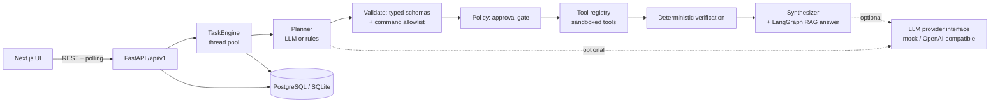

# Architecture

JARVIS is a **modular monolith**: one FastAPI process (with an in-process worker pool for tasks) plus PostgreSQL
(or SQLite for local dev) and a Next.js UI. There is deliberately no Kafka, Kubernetes or microservice split: nothing
in the current workload requires it (see "Scaling paths").

## Request flow: "run the tests"
1. `POST /api/v1/chat` stores the user message and a `Task` (idempotency key supported) and queues it. Returns `202`.
2. Worker thread: route label (rules, optional classifier) → plan. With a real provider the LLM proposes JSON; every step is
   validated against the tool's pydantic input schema **and** its `precheck` (e.g. command allowlist). Any failure falls back to
   the deterministic rule planner. Invalid plans never reach the database as steps.
3. Steps needing approval (`pytest`, `npm test`, `save_memory`) pause the task in `awaiting_approval` and **release the thread**.
   `POST …/steps/{id}/approve|reject` resumes it.
4. Execution: args re-validated, handler runs with a timeout in a tool pool, output validated against the output schema,
   an audit event is written. Cancellation sets an event that kills a running subprocess.
5. Verification is code, not model text: each step must have succeeded with schema-valid output. Task status is
   `succeeded` / `failed` / `partially_completed` from those results; the summary is built from recorded outputs, and a non-zero
   command exit is called out explicitly.
6. For document searches a **bounded LangGraph** workflow drafts an answer, verifies citation numbers, retries once, then falls
   back to extractive excerpts (see RAG_MEMORY.md).

## State ownership
| State | Owner | Lifetime |
|---|---|---|
| Users, conversations, messages | Postgres | until deleted by user |
| Tasks, steps, audit | Postgres (`tasks`, `task_steps`, `audit_events`) | kept for explainability; arguments logged, file contents and secrets are not |
| Long-term memory | `memories` | only what the user saves; separate from chat history |
| Documents + chunks + embeddings | `documents`, `document_chunks` (JSON vectors) | until deleted |
| Temporary task state | in-process (`_active`, cancel events) | process lifetime; interrupted `running` tasks are re-queued at startup |
| Provider secrets | environment variables only | never stored or returned |

## Concurrency & reliability
- `submit()` is guarded by an in-process lock so a task never runs twice concurrently; retries are bounded (3 attempts/step).
- Task creation is idempotent via a unique `(user_id, idempotency_key)` constraint.
- Provider failures (timeouts, bad JSON, invalid plans) fall back to rules and never corrupt task state; the engine has a last-resort
  handler so a task is never left in `running`.
- Rate limiting: per bearer token (600/min) and a strict per-IP limit on login/register (20/min); in-process (see limitations).
- Health: `/health`, `/health/ready`; metrics: `/metrics` (Prometheus text; measured request counts/latency and task gauges).
- Graceful shutdown waits (≤5 s) for in-flight tasks.

## Database access patterns
All queries filter on `user_id` (indexed). Lists are paginated (`limit`/`offset`, max 100–200). Chunk search loads the user's
indexed chunks and ranks in-process: fine for thousands of chunks, the first bottleneck beyond that.
Migrations: Alembic (`backend/migrations`); a test fails if models drift from migrations.

## Caching / queues
None yet. Redis and Celery were **not** introduced: the in-process pool plus DB-backed task state meets current needs and keeps
local setup free of extra services. Trade-off: tasks do not survive a host loss mid-step beyond the startup re-queue, and the
rate limiter is per process.

## Expected bottlenecks and scaling paths
1. Single-process task pool → move `TaskEngine` behind Celery/RQ with a DB-claim (`UPDATE … WHERE status=…`) per task.
2. In-memory chunk ranking → pgvector (`vector` column + HNSW) and Postgres FTS; the `embed()`/`hybrid_search()` seam is isolated in `services/retrieval.py`.
3. In-process rate limiter → Redis.
4. Command execution as the host user → containerised runner (see SECURITY.md).
